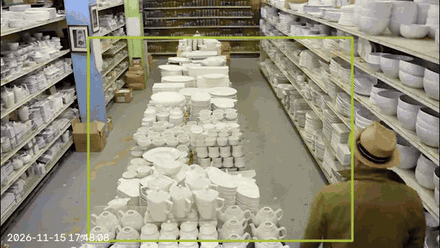
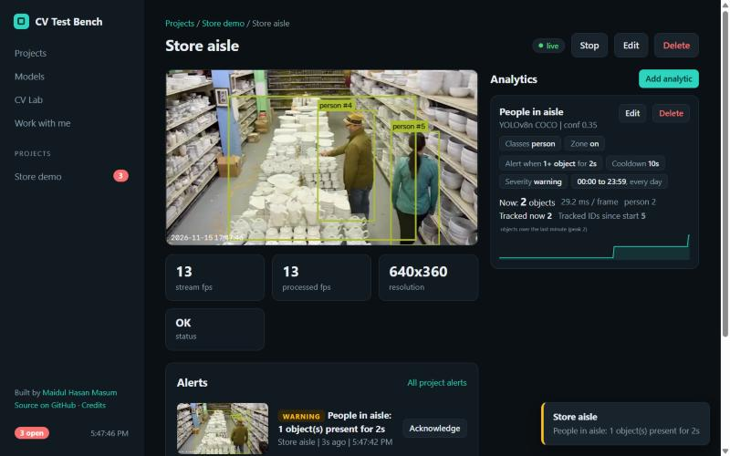

# CV Test Bench

A web dashboard for testing object detection models on live cameras and recorded video. Point it at an
RTSP stream, a video file or a webcam, pick a model, draw a zone, set an alert rule, and watch what the
model does frame by frame.

**Try it in your browser, nothing to install: https://mh-masum6875.github.io/cv-test-bench/**



The clip above is the server version running the bundled YOLOv8n model on the store sample, with a zone
drawn over the aisle. This is the dashboard around it:



## What it does

* Projects, cameras and analytics. One camera can run several models side by side.
* Sources: RTSP streams and uploaded video on the server. The browser version adds your webcam and HLS links.
* Models: a built-in motion detector, any YOLO detection model exported to ONNX, and `.pt` or `.engine`
  weights through Ultralytics. Each analytic card shows objects now, milliseconds per frame and a
  one-minute chart, so two models can be compared on the same footage.
* Zones, counting lines, tracking with IDs, and alert rules with dwell time, cooldown and a schedule.
  Alerts are saved with a snapshot and can be sent to a webhook.
* An Insights tab per project: sightings, a heatmap per camera that can be limited to one class, charts
  by hour and day, line crossings per hour, and CSV export.
* Ready-made example projects (stray dogs, traffic, a safety zone, counting bottles). In the server
  version, press **Add example projects** on the Projects page.
* The hosted site runs the same interface fully in the browser. Nothing is uploaded, and a model you
  add there stays on your computer.

## Run it

**Windows:** install Python 3.10 or newer, then

```
run.bat
```

The first start creates a virtual environment, installs the packages and opens http://127.0.0.1:8000.

**Mac or Linux:**

```bash
python -m venv .venv && . .venv/bin/activate
pip install -r requirements.txt
./scripts/dev.sh                   # then open http://127.0.0.1:8000
```

Add `pip install ultralytics` if you want to load `.pt` or `.engine` weights. ONNX models need nothing extra.

**Docker:** `docker build -t cv-test-bench . && docker run -p 8000:8000 -v $PWD/data:/app/data cv-test-bench`

The app listens on `127.0.0.1` by default. Set `HOST=0.0.0.0` to reach it from other machines. Set
`APP_USER` and `APP_PASSWORD` to put a login on it, and use HTTPS or a VPN in front.

## Results

Speed of the bundled detectors on the five bundled sample clips (640x360, 360 frames each, 1800 frames
per model). The time is for one `detect()` call: resize, inference and box filtering. Video decoding and
drawing are not included.

| Model | Input | Mean | Median | 95th percentile | Frames per second |
| --- | --- | --- | --- | --- | --- |
| Motion detector (background subtraction) | 480 px wide | 2.6 ms | 2.5 ms | 3.4 ms | 391 |
| YOLOv8n COCO, ONNX | 416x416 | 29.6 ms | 27.4 ms | 45.1 ms | 33.8 |
| YOLOv8n Open Images V7, ONNX | 416x416 | 37.8 ms | 36.8 ms | 44.9 ms | 26.4 |

Measured on 15 November 2026 on an AMD Ryzen 5 4600H laptop CPU (6 cores), no GPU, with Windows 11,
Python 3.13.12, ONNX Runtime 1.32.0 (CPU provider) and OpenCV 5.0.0. Frames per second is 1000 divided
by the mean time.

In the running server on the same machine, the store clip played at 13 frames per second and every frame
was processed by YOLOv8n COCO at about 25 to 30 ms each.

To repeat it: `python scripts/bench.py`. The per-clip numbers, the time of every frame and the software
versions are in [results/](results).

These are speed figures only. There is no accuracy figure here, because the sample clips have no labels.

## Test your own model

1. Open **Models, Add model**, give the path to your weights (or upload the file). Any file that
   Ultralytics can load works: `.pt`, `.onnx`, `.engine`, `.torchscript`.
2. On a camera, **Add analytic**, pick the model, and choose which classes to count.
3. Draw a zone if you only care about part of the frame.
4. Set the alert rule and press Start on the camera.

Each analytic card shows objects now, milliseconds per frame, and a one-minute chart, so you can
compare models on the same footage.

## Alert rules

| Setting | Meaning |
| --- | --- |
| Alert when | `objects are present` (N or more), `nothing is detected`, `an object is alone` (no companion such as a person nearby), `objects are in a group` (N or more within R object-heights of each other), `an object stays still` (its feet move less than a set share of the frame width for the hold time), or `an object crosses the line` (in, out or either way) |
| Counting line | Two points drawn on the picture. Every tracked object that crosses it is counted in each direction, whatever the rule. The arrow points to the "in" side |
| Must hold for | The condition has to stay true this many seconds before an alert fires (dwell time). For `an object stays still` it is the time without moving. A line crossing alerts at once |
| Wait between alerts | Cooldown, so one event does not flood you |
| Active on, From, Until | Days and a time window. Windows that cross midnight work, for example 22:00 to 06:00 |
| Severity | info, warning or critical |
| Webhook URL | Receives a JSON POST for every alert: camera, analytic, message, severity, counts, time |

## RTSP tips

* Use **Test connection** in the Add camera dialog first.
* Streams are read over TCP, which is more reliable than UDP on most networks.
* The newest frame is always processed. If your model is slower than the stream, frames are
  skipped instead of building up delay. **Process at most** sets the ceiling.
* If the stream drops, the camera shows `error` and reconnects by itself.
* Passwords in the URL are hidden in the tables.

## Stray dog monitoring

One of the example projects watches dogs on a street: a dog with no person near it, a pack of three or
more, a dog that stops moving, and dogs crossing the road, with a dog-only heatmap and a CSV export. The
details and its limits are in [docs/STRAY_DOGS.md](docs/STRAY_DOGS.md).

## Where things are

```
app/main.py        API routes
app/runner.py      one worker per camera: read, detect, apply rules, draw
app/detectors.py   Motion, Ultralytics, ONNX Runtime and RF-DETR detectors. Add your own here
app/tracking.py    tracker, and the alone, group, still and line crossing checks
app/examples.py    the ready-made example projects for the server version
app/rules.py       dwell time, cooldown and schedule logic
app/db.py          SQLite tables
docs/              the web interface (plain JavaScript, no build step). Also what GitHub Pages serves
docs/demo.js       the in-browser backend used when no server is running
docs/vendor/       TensorFlow.js, COCO-SSD and hls.js, bundled so the site needs no CDN
docs/models/       the COCO-SSD and YOLOv8n weights used by the browser demo
scripts/bench.py   the timing script behind the results table
results/           its raw output
data/              database, uploaded videos and models, alert snapshots
```

To use a model that is not Ultralytics, subclass `Detector` in `app/detectors.py`, return
`{label, conf, box}` dictionaries, and add it to `build_detector`.

## Check that it works

```bash
pip install pytest requests
python -m pytest tests/test_tracking.py tests/test_rules.py tests/test_analytics.py
python tests/test_api.py http://127.0.0.1:8000 samples/demo.mp4     # with the server running
```

## Known limits

* The bundled models are YOLOv8n, the smallest size, at 416 pixels. They are there so the demo loads
  fast. Small or distant objects are missed. Bring your own model for real use.
* The browser version runs on the CPU through WebAssembly and is slower than the server. It cannot open
  RTSP streams.
* There are no user accounts. The only protection is one shared login set with `APP_USER` and `APP_PASSWORD`.
* One process and SQLite. It is a test tool for a handful of cameras, not a video management system.
* The tracker is simple IoU matching. An object hidden for a few seconds comes back with a new ID, and
  a fast object at a low frame rate can be missed by a counting line. Raise **Process at most** for fast
  traffic.
* I tested the server on Windows 11 with Python 3.13. The Mac, Linux and Docker commands are not covered by that test.
* RF-DETR support is written against the rfdetr package but has not been run.

## Licence

My code is MIT, see [LICENSE](LICENSE). The bundled YOLOv8n weights are AGPL-3.0 from Ultralytics, so
swap them for your own model in a commercial product. Credits for the models and sample footage are in
[NOTICE.md](NOTICE.md).

Built by [Maidul Hasan Masum](https://mh-masum6875.github.io). If you need a model trained, made faster
or checked on your own cameras, see [Work with me](https://mh-masum6875.github.io/cv-test-bench/#/work).
